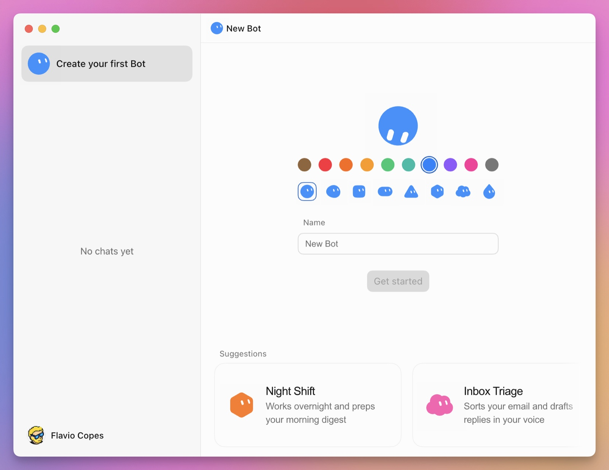

# Waddle — Aplicativo Android Nativo

> Interface conversacional com agentes inteligentes e gerenciamento de rotinas automatizadas, desenvolvida nativamente para Android.

---

## 📸 Telas do Aplicativo

<p align="center">
  
  
  
  
</p>

---

## 🚀 Funcionalidades

- **Boas-vindas & Onboarding (`SplashActivity`)**: Animação suave com a identidade visual amarela da Waddle e tipografia Inter.
- **Lista & Busca de Agentes (`MainActivity`)**:
  - Listagem dos agentes disponíveis (West, Ted, Batman, Kyle, Songbird, Sheldon, Hal, Pam, etc.).
  - Filtro e pesquisa instantânea por nome ou especialidade.
  - Indicadores de status e cores de destaque individuais por agente.
  - Navegação inferior (Agentes, Rotinas, Plugins e Perfil).
- **Conversa Fluida & Inteligente (`ChatActivity`)**:
  - Cards com sugestões de prompt na primeira conversa.
  - Balões de conversa customizados (Usuário, Agente e Mensagens de Sistema).
  - Simulação de digitação em tempo real e respostas contextuais.
  - Suporte a comandos de voz e microfone com verificação de permissões.
  - Reconhecimento automático e criação de rotinas agendadas.
- **Gerenciador de Rotinas (`RoutineActivity`)**:
  - Visualização e ativação/desativação de rotinas diárias com switch nativo.
  - Configuração de instruções automáticas e horários programados.

---

## 🛠️ Tecnologias e Dependências

- **Linguagem**: Java (Nativo Android)
- **Design System**: Material Design 3 com tokens customizados Waddle
- **Tipografia**: Família de fontes Inter (`Regular`, `SemiBold`, `Bold`)
- **Bibliotecas**:
  - `androidx.appcompat:appcompat:1.6.1`
  - `com.google.android.material:material:1.11.0`
  - `androidx.recyclerview:recyclerview:1.3.2`
  - `androidx.constraintlayout:constraintlayout:2.1.4`
  - `com.squareup.okhttp3:okhttp:4.12.0`
  - `com.google.code.gson:gson:2.10.1`
- **Build System**: Gradle 9.7.1 + Android Gradle Plugin (AGP) 9.4.1

---

## 📂 Estrutura do Projeto

```
WaddleApp/
├── app/
│   ├── build.gradle
│   ├── proguard-rules.pro
│   └── src/main/
│       ├── AndroidManifest.xml
│       ├── java/com/waddle/app/
│       │   ├── WaddleApplication.java
│       │   ├── activities/
│       │   │   ├── SplashActivity.java
│       │   │   ├── MainActivity.java
│       │   │   ├── ChatActivity.java
│       │   │   └── RoutineActivity.java
│       │   ├── adapters/
│       │   │   ├── AgentListAdapter.java
│       │   │   └── MessageAdapter.java
│       │   └── models/
│       │       ├── Agent.java
│       │       ├── AgentRepository.java
│       │       └── Message.java
│       └── res/
│           ├── color/
│           ├── drawable/
│           ├── font/
│           ├── layout/
│           ├── menu/
│           └── values/
├── docs/screenshots/
├── gradle/wrapper/
├── build.gradle
├── gradle.properties
├── settings.gradle
└── README.md
```

---

## 💻 Como Compilar e Gerar o APK

Clone o repositório e compile usando o Gradle Wrapper:

```bash
# Compilar versão Debug e gerar o APK
./gradlew assembleDebug
```

O arquivo gerado estará em:
`app/build/outputs/apk/debug/app-debug.apk`
