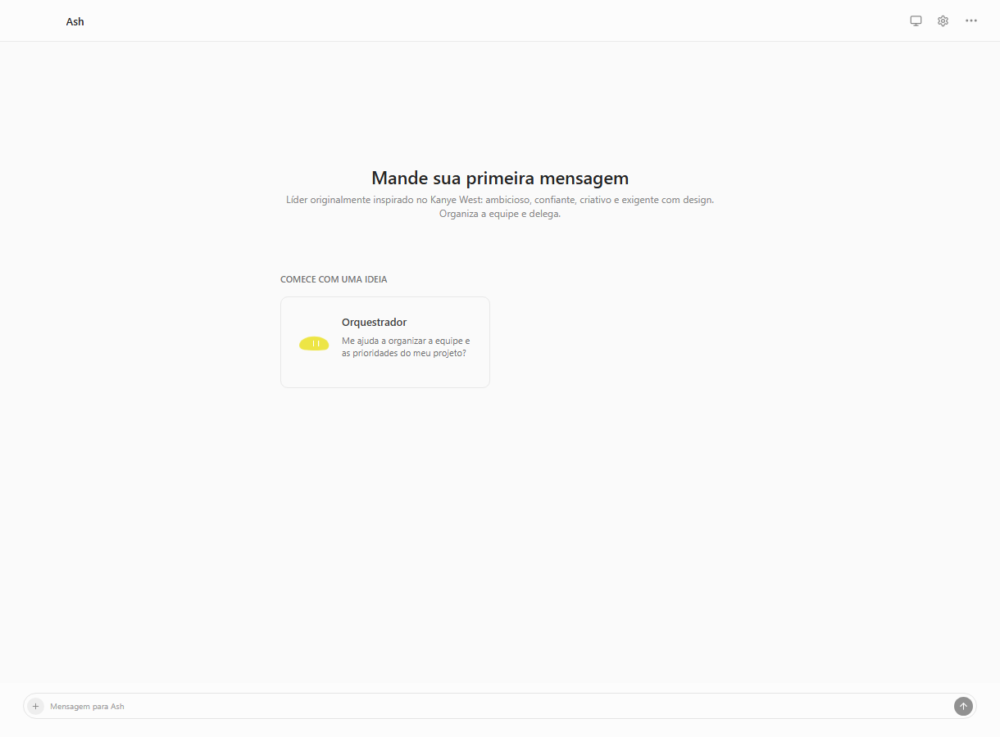
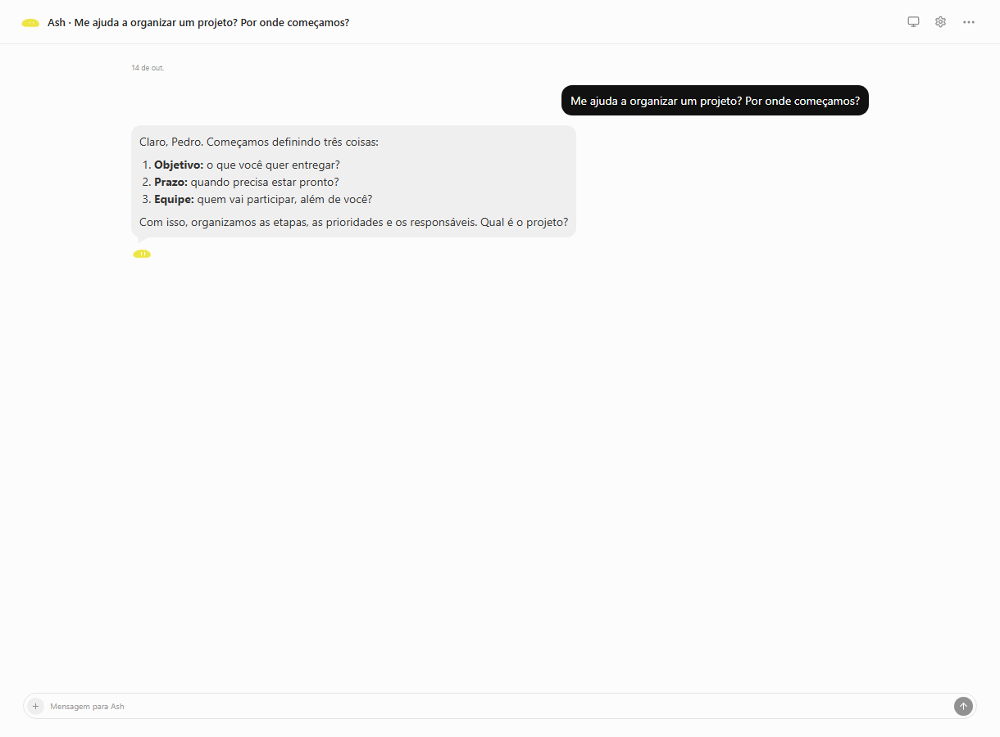
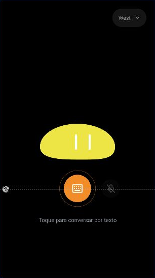

# Wendler

Wendler é um assistente pessoal formado por uma equipe de agentes com mascotes e especialidades próprias. A proposta é conversar com eles para pesquisar, organizar projetos, trabalhar com arquivos e executar tarefas nos serviços e computadores conectados.

O projeto reúne a interface web, o backend e um aplicativo nativo exclusivo para Android. O backend e os executores podem rodar em um servidor Linux, permitindo acessar o sistema sem manter o computador pessoal ligado. O acesso remoto depende da rede privada e das integrações configuradas nesse servidor.

## Aplicativo Android

O Android funciona como a tela dedicada do mascote: fundo preto, personagem centralizado, seletor de mascotes e acesso à conversa. As formas vetoriais foram extraídas dos desenhos originais do Pencil. O mascote respira suavemente e pisca; a seleção é salva no aparelho. Os controles de voz ficam para uma etapa posterior.

A tela dedicada é a entrada do APK e se conecta ao mesmo servidor da interface web. Nesta etapa, o botão central abre uma conversa por texto; voz e respostas faladas ficam para depois. O Android retoma a conversa individual mais recente do agente, compartilha o histórico com a web e usa as personalidades, memórias autorizadas e permissões salvas no servidor. Conversas privadas, arquivadas e projetos não são escolhidos automaticamente. As telas antigas de lista, chat e rotinas permanecem no código legado, mas não fazem parte da entrada atual. Nenhuma resposta simulada é emitida pela tela do mascote.

O celular precisa estar na mesma rede Tailscale do servidor. Nenhuma chave de modelo é armazenada no APK. Cards e widgets ficam registrados na conversa web e podem ser vistos pela ação **Abrir no painel**. O app não reenvia automaticamente mensagens após falha de rede; uma tarefa já iniciada pode continuar no servidor e sua resposta aparecerá ao atualizar a conversa. Ações que exigirem autorização continuam mostrando a confirmação do servidor.

## Telas reais

As imagens abaixo mostram o código atual do Wendler. Não são desenhos do Pencil nem referências de outro produto.

### Web para computador

Capturas da interface em execução no servidor em 14/10/2026. A área central foi recortada para não publicar os dados pessoais e prévias de outras conversas da barra lateral. A resposta da segunda imagem foi produzida pelo agente real.





### Aplicativo nativo Android

**Prévia do layout nativo no Android Studio**, gerada a partir do XML e dos recursos do aplicativo atual. Esta imagem ainda não é uma captura do APK em execução: o emulador estava offline. A linha pontilhada é uma guia do editor e não aparece no aplicativo. A captura será substituída por uma imagem do aparelho quando a execução estiver disponível.



[Ver a captura original no Android Studio](docs/screenshots/android-studio-preview.png)

## Organização

| Caminho | Conteúdo |
| --- | --- |
| `app/` | Aplicativo nativo Android existente, em Java e XML. |
| `src/` | Interface web em React, TypeScript e CSS. |
| `server/` | Backend, ferramentas e integrações dos agentes em JavaScript. |
| `deploy/` | Configuração dos serviços no servidor. |
| `docs/` | Planos, instruções de configuração e verificações. |

Cada plataforma tem seu próprio processo de compilação. O Android não inclui o backend dentro do APK.

## Executar o Android

Abra a raiz deste repositório no Android Studio. Instale os componentes solicitados pelo SDK Manager, aguarde a sincronização e selecione um celular conectado ou um dispositivo no Device Manager. Execute a configuração `app` para abrir o aplicativo real.

Para gerar o APK no Windows, com o SDK configurado e um JDK compatível:

```powershell
.\gradlew.bat assembleDebug
```

O APK fica em `app/build/outputs/apk/debug/app-debug.apk`. A configuração atual requer Android 8.0/API 26 ou superior. O caminho do SDK é uma configuração local e não deve ser publicado.

## Executar a interface web e o backend

Na raiz do repositório, instale as dependências com pnpm e execute:

```sh
pnpm install
pnpm start
```

Consulte [`docs/RUNTIME-LOCAL.md`](docs/RUNTIME-LOCAL.md) para configurar o runtime e [`deploy/runtime/README.md`](deploy/runtime/README.md) para executar no servidor.

Credenciais, dados pessoais, sessões de navegador e chaves de criptografia pertencem à configuração privada do ambiente e não devem ser incluídos no repositório.


## Ilha dos agentes para Windows

A ilha acompanha as atividades do servidor em uma janela transparente no topo do computador, com mascotes originais, expansão animada, tarefas paralelas, autorizações, interrupção e acesso à conversa. Também pode exibir o QR Pix realmente emitido por uma tarefa. CPU e memória são lidas do Windows local; temperatura, GPU e otimizações automáticas ainda não estão integradas.

Abra com `pnpm island`; use **Ctrl + Alt + Espaço** para expandir ou recolher. A instalação e os limites desta primeira versão estão em [Ilha para Windows](docs/ILHA-WINDOWS.md).
