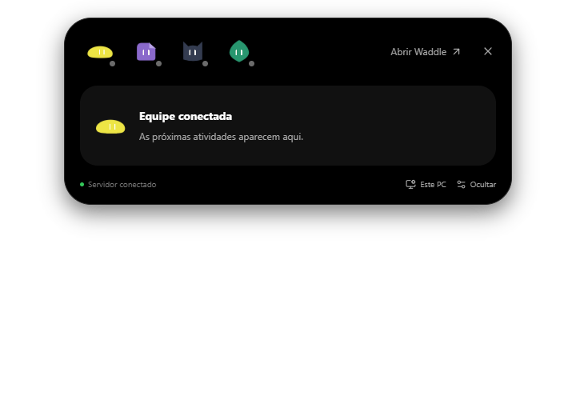

# Ilha dos agentes no Windows

Primeira versão funcional da ilha desenhada no Pencil. A janela é um aplicativo desktop com Electron: transparente, sem moldura, centralizada no topo e sobre os outros aplicativos. O restante da área transparente deixa os cliques passarem. O backend continua no servidor Linux; fechar a ilha não interrompe os agentes.

## Abrir

Na raiz do projeto, com as dependências principais já instaladas:

```powershell
pnpm --dir desktop install --ignore-workspace
pnpm --dir desktop run setup
pnpm island:build
pnpm island
```

A ilha precisa do Tailscale conectado para acessar o servidor configurado em `desktop/main.cjs`. Não há credenciais de modelo no cliente Windows. Esta versão usa a instalação de desenvolvimento; ainda não inclui instalador distribuível.

- **Ctrl + Alt + Espaço** abre ou recolhe o painel.
- Passe o cursor sobre a ilha ou clique para expandir; Escape recolhe.
- O ícone na bandeja permite mostrar, ocultar, abrir o painel web, acompanhar o Firefox do servidor e sair.
- Iniciar com o Windows é opcional e vem desativado.

## Conectado nesta etapa

- Atividade real dos agentes, execução paralela, tempo decorrido e resposta concluída, interrompida ou com erro.
- Interromper tarefas em andamento usando o cancelamento existente no servidor.
- Consultar os detalhes e responder às autorizações existentes.
- Abrir a conversa correta no painel web e acessar a visualização do computador do servidor.
- Mostrar o widget Pix quando o executor efetivamente emitir um QR; copiar o código quando disponível e recente. A ilha não gera cobranças nem efetua pagamentos.
- CPU e memória deste Windows, além do tempo de resposta do servidor.
- Mascotes originais, olhos acompanhando o cursor, piscadas, transições de expansão e indicação de atividade sem porcentagem inventada.

As atividades observadas são transitórias e começam quando esta versão do backend é iniciada. A ilha não reconstrói tarefas antigas. Respostas de conversas privadas e seus widgets não aparecem nela. Acesso remoto continua dependendo da rede privada configurada.

## Limites atuais

A pausa e a retomada de tarefas, temperatura, GPU e ações automáticas de otimização do PC ainda não estão conectadas. Os desenhos desses estados não são apresentados como recursos operacionais. A voz também não faz parte desta etapa.

## Validação

Compilação web e desktop, testes de atividade, decisões, cancelamento, privacidade, abertura da conversa correta e renderização dos principais estados. Teste adicional na janela nativa confirmou expansão, ausência de erros no renderer e permanência sobre outras janelas. Uma mensagem real ao Ash atravessou o backend e apareceu como atividade em execução e depois como resposta concluída. Nenhuma compra foi iniciada para estes testes.



## Placares e movimento

A ilha também acompanha até três partidas consultadas pelo Livro ou por outro agente com `wendler_sports`. A consulta inicial usa a data de Brasília e a competição indicada; se a competição não for conhecida, o agente consulta futebol geral. A fonte atual é o feed de placares da ESPN, acessado por HTTPS no servidor, sem chave. Esse feed público não tem garantia de disponibilidade ou de atualização instantânea; não é o MCP oficial da ESPN. A cobertura depende do campeonato.

O servidor reutiliza leituras por no máximo 15 segundos; a ilha consulta o servidor a cada 2,5 segundos quando não há tarefas em execução. O card do chat atualiza a cada 20 segundos. Esses intervalos são de consulta, não uma promessa de atraso máximo do fornecedor. O relógio é o informado pela fonte, sem simular minutos. Partidas agendadas não recebem 0 a 0 fictício. Falhas de consulta mantêm o último dado identificado como sem atualização, com o horário da leitura; uma leitura com mais de 45 segundos também recebe essa indicação.

O acompanhamento é salvo no servidor e retomado após reinício, por até 36 horas; o usuário pode encerrá-lo pelo botão do placar. Conversas privadas não podem iniciar esse acompanhamento compartilhado. A aprovação de ações dos agentes continua tendo prioridade sobre o placar.

Largura, altura e cantos agora usam uma única transição interrompível de 420 ms. A abertura pelo cursor tem espera de 180 ms e respeita a preferência do Windows de reduzir movimento. Clicar fora da ilha recolhe o painel mesmo quando ela não recebeu foco. O aplicativo lê apenas o estado do botão principal do mouse no Windows, sem registrar teclas, texto ou histórico de cliques. O comportamento foi validado com um clique real em outra janela.

O placar compacto tem um botão X com a descrição ‘Remover placar da ilha’. Ele encerra o acompanhamento no servidor e mantém a conversa e o histórico. O painel expandido oferece a mesma ação em cada partida.

